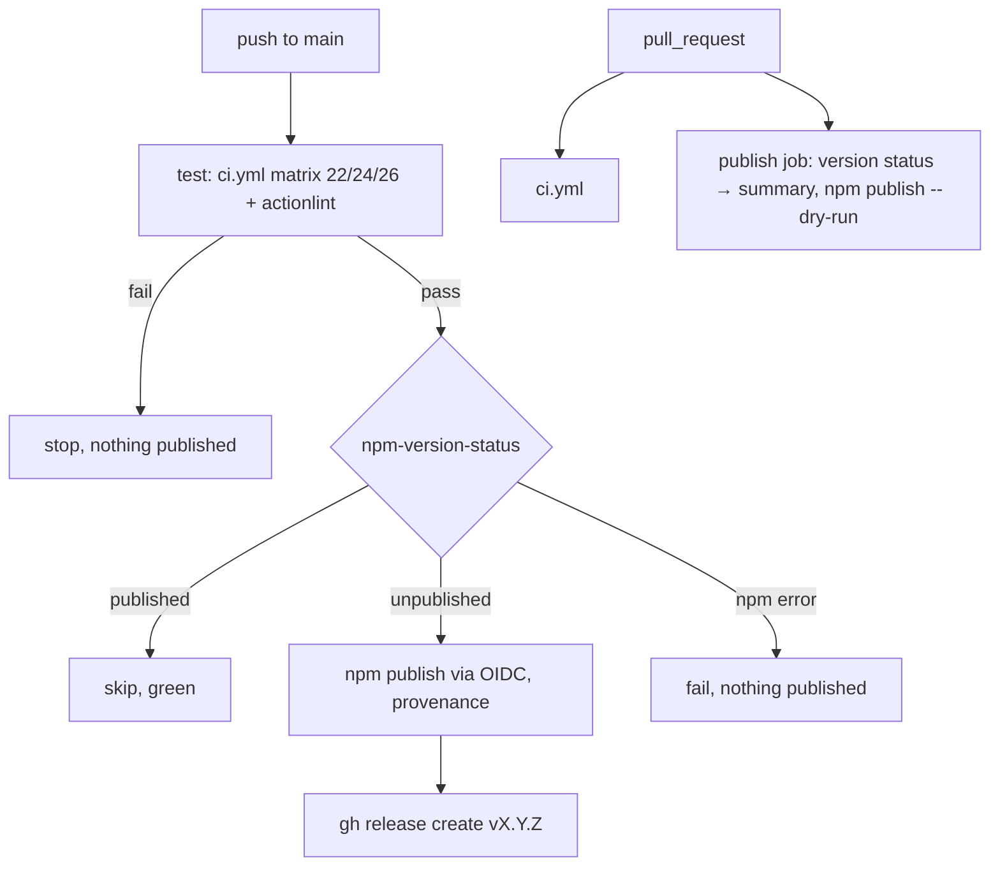

# Publish to npm from GitHub Actions on push to main

Issue: #11

## Goal

A push to `main` runs a GitHub Actions workflow that:

1. tests the package on Node 22, 24 and 26;
2. if the `package.json` version is not on npm yet, publishes it with npm trusted publishing (OIDC, no stored token, automatic provenance);
3. tags the release `vX.Y.Z` and creates a GitHub Release.

If the version is already on npm, the run finishes green without publishing, so bumping `version` in a PR is how a release is triggered.

A separate CI workflow runs actionlint plus build and tests on every pull request and on pushes to `dev`. Every pull request also exercises the publish workflow end to end with `npm publish --dry-run`.

This PR bumps the package to `0.4.0` (console capture, #9) and `engines.node` to `>=22`. The next `dev` → `main` merge is then the first automated release.

## Non-goals

- Automatic version bumping, changelog generation, changesets or conventional commits. Versions are bumped by hand in PRs.
- Publishing from tags or manually (`workflow_dispatch`).
- Staged publishing (2FA approval per release) and npm dist-tags other than `latest`.
- Branch or tag protection rules, required status checks, and GitHub environments. These are repository settings, not files.
- Configuring the trusted publisher on npmjs.com. That is a one-time manual step by the package owner, documented in the README.
- Restricting token-based publishing on npmjs.com ("disallow tokens"). Recommended once trusted publishing is proven; documented, not automated.
- Testing Node 18 or 20 (both EOL).
- Merging `dev` → `main` or publishing `0.4.0` as part of this PR.

## Context

- **Current state:**
  - No CI: `.github/` holds only `copilot-instructions.md`.
  - Releases are manual `npm publish` runs; `prepublishOnly` runs `npm run build && npm test` (`package.json:31`).
  - Releases are tagged by hand: `v0.2.0` and `v0.3.0` exist, `0.1.0` was never tagged.
- **npm registry:** `observed-js` has versions 0.1.0, 0.2.0 and 0.3.0; `latest` is 0.3.0; there is one maintainer (`alexmason93`). `repository.url` is `git+https://github.com/AlexMason/observed-js.git`, which trusted publishing requires to match the repo.
- **Repo:** `AlexMason/observed-js` is **public**, so provenance is generated. The default branch is `main`.
- **Branches:** `origin/dev` is 2 commits ahead of `origin/main` (the Landmark bootstrap and #9). `package.json` is `0.3.0`, which npm already has, so without a bump the next release merge would publish nothing.
- **`package.json`:** `"engines": { "node": ">=18.0.0" }` (`:62-64`). `README.md:5` says "Node >= 18".
- **`package-lock.json` root entry is stale:** `"name": "observed"`, `"license": "ISC"` and no `engines`, against `observed-js`/MIT in `package.json`. `npm ci` accepts this because it only validates dependency specs. `npm install --package-lock-only` regenerates the root entry.
- **Tests:** `npm run build && npm test` gives 186 passed on Node 22.21.1 locally. Run under `npx -p node@24` and `node@26`, it also gives 186/186 on **24.22.3** and **26.13.1**. The suite takes about 15 s.
- **`npm view observed-js@<v> version`:**
  - published version: prints it and exits 0;
  - missing version: exits **1 with `npm error code E404`**;
  - other failures (network, auth): also exit 1, without `E404`.
- **`npm publish --dry-run`** exits 0 even for an already-published version (checked with 0.3.0). The dry run doesn't detect "version exists", so an explicit check is needed.
- **npm trusted publishing** (docs.npmjs.com/trusted-publishers):
  - Requires npm CLI ≥ 11.5.1, Node ≥ 22.14 and GitHub-hosted runners.
  - The workflow needs `permissions: id-token: write`.
  - The publisher is bound to the exact workflow **filename**.
  - Configs created after 2026-09-03 default to stage-only, so "allow `npm publish`" must be ticked.
  - A new config **expires if its first successful publish doesn't happen within 2 days**.
  - Provenance is automatic.
  - With `workflow_call`, npm validates against the *calling* workflow's name. That only matters for a called workflow that publishes.
- **Current action releases:** `actions/checkout` v7.0.1, `actions/setup-node` v7.1.0 (inputs include `registry-url` and `package-manager-cache`), `rhysd/actionlint` v1.7.12.
- `actionlint` is not installed locally.
- **Landmark `test_command`:** `npm run build && npm test`.

## Decisions

| # | Decision | Alternative considered | Reason |
| - | -------- | ---------------------- | ------ |
| 1 | Publish only when the `package.json` version is not on npm. Already published → the run finishes green with no publish. Bumping `version` in a PR is the release trigger | CI bumps the version; fail when the version is unchanged | User choice. No commits from CI, and pushes to `main` that aren't releases don't fail |
| 2 | The version check is a script, `.github/scripts/npm-version-status.sh`. It prints `published` (exit 0) when npm has the version and `unpublished` (exit 0) on `E404`; any other `npm view` failure exits non-zero and fails the job | Inline shell; treat any non-zero as "unpublished" | A network or auth error must not look like "go ahead and publish". As a file, the logic can be smoke-tested locally |
| 3 | Authenticate with **npm trusted publishing, direct `npm publish`** (OIDC). `id-token: write` only on the publish job | Staged publishing; an `NPM_TOKEN` secret | User choice. No long-lived token, automatic provenance |
| 4 | The publish job runs on **Node 24** and installs `npm@11` globally before publishing | Node 26; rely on the bundled npm | User choice for Node 24 (Active LTS). Installing npm 11 guarantees ≥ 11.5.1 whatever npm the runner's Node 24 bundles |
| 5 | Publish requires the test matrix to pass. The publish job also keeps `prepublishOnly` (build and test again on Node 24, against the exact artifact being published) | Build only; `--ignore-scripts` | User choice: build plus the full suite. Keeping `prepublishOnly` means the publish job itself never ships an untested build. Cost: about 15 s |
| 6 | Test matrix **Node 22 / 24 / 26** | 20/22/24; 18–24 | User choice |
| 7 | `engines.node` → **`>=22`** in `package.json`, the lockfile root and README | Keep `>=18` untested | User choice. Declared support matches tested support |
| 8 | After a run that **published**, create tag `vX.Y.Z` at `github.sha` and a GitHub Release with generated notes (`gh release create`) | Tag only; nothing; tag whenever the tag is missing | User choice for tag plus Release. Only publishing runs tag, so a stale version (e.g. the untagged 0.1.0) can never be tagged at the wrong commit. A failed release step after a successful publish is fixed by hand (README) |
| 9 | Two workflow files. `ci.yml` (on `pull_request`, `push` to `dev`, and `workflow_call`) runs actionlint plus the test matrix. `publish.yml` (on `push` to `main` and `pull_request`) calls `ci.yml` for tests on push, then runs `publish` | One combined workflow; no PR CI | User choice to add PR CI. `publish.yml` is the filename registered with npm and the only file that runs `npm publish`. Calling `ci.yml` (which doesn't publish) avoids the `workflow_call` validation caveat |
| 10 | On pull requests, `publish.yml` runs the publish job in **dry-run mode**: the version check (reported in the job summary as "a merge to main would publish X" or "… would skip") plus `npm publish --dry-run`. Tests are not duplicated, since `ci.yml` already runs on the PR | actionlint only; no dry run | User choice. Everything except the upload and release is exercised before merge |
| 11 | actionlint runs in `ci.yml` through `docker://rhysd/actionlint:1.7.12` | The download script; a third-party action | Official image, pinned version, no extra install step |
| 12 | Actions pinned to major tags `actions/checkout@v7` and `actions/setup-node@v7`. `package-manager-cache: false` in the publish job | Pin to SHAs; enable caching | Current majors. npm docs recommend no cache in release builds. CI jobs may cache |
| 13 | Permissions: workflow-level `contents: read`; the `publish` job adds `contents: write` (release) and `id-token: write` (OIDC) | Workflow-wide write | Least privilege. PRs from forks get read-only tokens automatically, which is fine for the dry run |
| 14 | Concurrency: `publish.yml` uses group `publish-${{ github.ref }}`, cancelling in-progress runs only for pull requests. `ci.yml` uses group `ci-${{ github.ref }}` and cancels in progress | No concurrency control | Two quick pushes to `main` must not race the publish. Superseded PR runs are wasted work |
| 15 | This PR bumps `version` to **0.4.0** (`npm version 0.4.0 --no-git-tag-version`) and resyncs the lockfile root with `npm install --package-lock-only` | A separate release PR | User choice. The next `dev` → `main` merge is the first automated release |
| 16 | README gets a "Releasing" section: bump `version` in a PR, merge to `dev`, then `dev` → `main` publishes, tags and releases. It also covers the one-time trusted-publisher setup (owner `AlexMason`, repo `observed-js`, workflow `publish.yml`, no environment, allow `npm publish`, configure within 2 days of the first release merge), recovery for a failed release step, and the recommendation to disallow tokens afterwards | Plan only | The npm-side steps are manual and easy to get wrong (exact filename, 2-day expiry) |

## Design

### Files

```
.github/scripts/npm-version-status.sh   # new, executable
.github/workflows/ci.yml                # new
.github/workflows/publish.yml           # new
package.json                            # version 0.4.0, engines >=22
package-lock.json                       # regenerated root (name, version, license, engines)
README.md                               # Node >= 22; "Releasing" section
```

### `.github/scripts/npm-version-status.sh`

```bash
#!/usr/bin/env bash
# Usage: npm-version-status.sh <package> <version>
# Prints "published" or "unpublished"; exits non-zero on any other npm error.
set -euo pipefail
pkg="$1"; version="$2"
if out=$(npm view "${pkg}@${version}" version 2>&1); then
  [[ "$out" == "$version" ]] && { echo published; exit 0; }
  echo "unexpected npm view output: $out" >&2; exit 1
fi
if grep -q "E404" <<<"$out"; then echo unpublished; exit 0; fi
echo "npm view failed: $out" >&2; exit 1
```

### `.github/workflows/ci.yml`

```yaml
name: CI
on:
  pull_request:
  push:
    branches: [dev]
  workflow_call:
permissions:
  contents: read
concurrency:
  group: ci-${{ github.ref }}
  cancel-in-progress: true
jobs:
  actionlint:
    runs-on: ubuntu-latest
    steps:
      - uses: actions/checkout@v7
      - uses: docker://rhysd/actionlint:1.7.12
        with: { args: -color }
  test:
    runs-on: ubuntu-latest
    strategy:
      fail-fast: false
      matrix:
        node: [22, 24, 26]
    steps:
      - uses: actions/checkout@v7
      - uses: actions/setup-node@v7
        with: { node-version: "${{ matrix.node }}", cache: npm }
      - run: npm ci
      - run: npm run build
      - run: npm test
```

When `ci.yml` is called from `publish.yml`, its `concurrency` group uses the caller's ref. The caller has its own concurrency group, so the two don't conflict.

### `.github/workflows/publish.yml`

```yaml
name: Publish
on:
  push:
    branches: [main]
  pull_request:
permissions:
  contents: read
concurrency:
  group: publish-${{ github.ref }}
  cancel-in-progress: ${{ github.event_name == 'pull_request' }}
jobs:
  test:
    if: github.event_name == 'push'
    uses: ./.github/workflows/ci.yml
  publish:
    needs: test
    if: ${{ !cancelled() && (needs.test.result == 'success' || needs.test.result == 'skipped') }}
    runs-on: ubuntu-latest
    permissions:
      contents: write
      id-token: write
    steps:
      - uses: actions/checkout@v7
      - uses: actions/setup-node@v7
        with:
          node-version: 24
          registry-url: https://registry.npmjs.org
          package-manager-cache: false
      - run: npm install -g npm@11
      - run: npm ci
      - id: version
        run: |
          version=$(node -p "require('./package.json').version")
          status=$(.github/scripts/npm-version-status.sh observed-js "$version")
          echo "version=$version" >> "$GITHUB_OUTPUT"
          echo "status=$status" >> "$GITHUB_OUTPUT"
      - name: Report (pull request)
        if: github.event_name == 'pull_request'
        run: |
          if [ "${{ steps.version.outputs.status }}" = unpublished ]; then
            echo "A merge to main would publish observed-js@${{ steps.version.outputs.version }}." >> "$GITHUB_STEP_SUMMARY"
          else
            echo "A merge to main would skip publishing: observed-js@${{ steps.version.outputs.version }} is already on npm." >> "$GITHUB_STEP_SUMMARY"
          fi
      - name: Publish (dry run)
        if: github.event_name == 'pull_request'
        run: npm publish --dry-run
      - name: Publish
        if: github.event_name == 'push' && steps.version.outputs.status == 'unpublished'
        run: npm publish
      - name: Skip (already published)
        if: github.event_name == 'push' && steps.version.outputs.status == 'published'
        run: echo "observed-js@${{ steps.version.outputs.version }} is already on npm; nothing to publish." >> "$GITHUB_STEP_SUMMARY"
      - name: Tag and GitHub Release
        if: github.event_name == 'push' && steps.version.outputs.status == 'unpublished'
        env:
          GH_TOKEN: ${{ github.token }}
        run: gh release create "v${{ steps.version.outputs.version }}" --target "${{ github.sha }}" --title "v${{ steps.version.outputs.version }}" --generate-notes
```

`npm publish` runs `prepublishOnly` (`npm run build && npm test`), which builds and tests on Node 24 inside the publish job (Decision 5). On pull requests, the `npm publish --dry-run` step runs it too.

### Control flow



## Testing

There is no runner for workflow files in `test_command`, so each step is checked as follows:

- **Step 1 (version/engines):** `npm run build && npm test` passes. `npm ci` succeeds from the regenerated lockfile. `node -p "require('./package.json').engines"` shows `>=22`. The lockfile root shows `observed-js`, `0.4.0`, `MIT` and `engines.node >=22`.
- **Step 2 (script):** throwaway local smoke runs:
  - `npm-version-status.sh observed-js 0.3.0` → `published`, exit 0;
  - `… 0.4.0` → `unpublished`, exit 0;
  - with `npm_config_registry=http://127.0.0.1:9` → non-zero exit and an error on stderr.
- **Steps 3–4 (workflows):** actionlint 1.7.12 (downloaded to `/tmp` with its official download script, throwaway) reports no errors for `.github/workflows/*.yml`. That covers its built-in shellcheck of `run:` blocks when available.
- **End to end before merge (at filing):** the PR's own checks.
  - `CI / actionlint`, plus `CI / test (22|24|26)`, all green.
  - `Publish / publish` green, with the summary saying "A merge to main would publish observed-js@0.4.0." and the `npm publish --dry-run` output listing `observed-js@0.4.0`.
  - Checked with `gh pr checks` and `gh run view`.
- **First real release (after merge, user-gated):** this PR merges to `dev`, which runs `CI` on push. Then the owner:
  1. creates the npm trusted publisher (`AlexMason` / `observed-js` / `publish.yml`, no environment, allow `npm publish`) within 2 days before merging;
  2. merges `dev` → `main`;
  3. checks that `Publish` publishes `observed-js@0.4.0` with provenance (`npm view observed-js@0.4.0` and the provenance badge on npmjs.com), creates tag `v0.4.0`, and creates a GitHub Release.

  A later push to `main` without a version bump should finish green with "already on npm; nothing to publish".

## Steps

- [x] 1. Bump `version` to `0.4.0` and `engines.node` to `>=22` (`package.json`), regenerate the lockfile root (`npm install --package-lock-only`), and update `README.md:5` to "Node >= 22". Check: `npm ci && npm run build && npm test`.
- [ ] 2. Add `.github/scripts/npm-version-status.sh` (executable). Check: the three local smoke runs in Testing.
- [ ] 3. Add `.github/workflows/ci.yml`. Check: actionlint clean.
- [ ] 4. Add `.github/workflows/publish.yml`. Check: actionlint clean on both workflows.
- [ ] 5. README "Releasing" section (Decision 16). Check: the steps match `publish.yml` and the npm docs fields.

## Risks & open questions

- *Accepted:* timing-sensitive tests (rate limiting, timeouts) may flake on shared runners. A flaky failure blocks or delays a publish but never publishes a bad build; re-run the job.
- *Accepted:* if the trusted-publisher fields on npmjs.com are wrong, the first release fails with `ENEEDAUTH` (npm doesn't validate the config when saved). Fix the config and re-run the job; the version is still unpublished, so it publishes.
- *Accepted:* the trusted-publisher config expires if not used within 2 days. Create it right before the release merge (README).
- *Accepted:* if `npm publish` succeeds but `gh release create` fails, a re-run skips (the version is on npm) and doesn't tag. Run `gh release create vX.Y.Z --target <sha> --generate-notes` by hand (README).
- *Accepted:* `npm install -g npm@11` takes the newest 11.x at run time, so the minor version isn't pinned.
- *Accepted:* raising `engines` to `>=22` makes npm/pnpm warn users on Node 18/20; installs still succeed by default.
- *Accepted:* the publish job runs build and tests twice on Node 24 (the matrix, then `prepublishOnly`), about 15 s extra per release.
- *Accepted:* actions are pinned to major tags, not commit SHAs.

## Implementation notes

## Review
