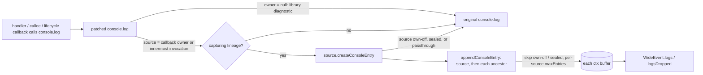

# Capture console.* output from action invocations on the wide event

Issue: #9

## Goal

Console capture is on by default.

- Every `console.log/info/warn/error/debug/trace` call made while an action invocation runs ends up in that invocation's `WideEvent.logs`. This covers calls from plain code the handler calls and from the action's lifecycle callbacks (`onEvent`, `onProgress`, `shouldRetry`, `onWarning`).
- Each call is also copied into the `logs` of every capturing ancestor invocation, so a root event shows the whole trace's console output in one array.
- Each entry carries the `actionId` of the invocation that made it, so a dashboard can narrow a trace down to one event.
- Attribution stays correct when invocations run concurrently.
- Users opt out globally (`setConsoleCapture(false)`) or per action (`.captureConsole(false)`).
- Handlers need no code changes, and output still prints to the terminal unless the user sets `passthrough: false`.
- Importing the library has no side effect. `console` is patched only when the first invocation with capture on starts.

## Non-goals

- Capturing output that bypasses `console`: `process.stdout.write`, pino/sonic-boom, native addons.
- Capturing from worker threads or child processes.
- Patching `console.dir/table/group/assert/count/time*`. Methods that Node implements by calling a captured method on `console` (`table`, `group`, `count`, `timeEnd` and `timeLog` call `log`; a failing `assert` calls `warn`) are recorded under that level with Node's rendered text. `dir` and `dirxml` write to the stream directly and are not recorded.
- Stack traces for `console.trace`: only the formatted message is recorded.
- Keeping raw argument references on entries.
- The library writing its own timeline entries (retry scheduled, timed out, cancelled) into `logs`. Its own `console.error` diagnostics stay uncaptured.
- An uninstall API or restoring the original console methods.
- Changing which ALS context user callbacks run in, or the trace/parent linkage of actions invoked from callbacks.
- Browser or non-Node runtimes (the library already imports `node:async_hooks`).
- A `docs/plan/` rationale doc; this plan is the design record.

## Context

- `src/actions/index.ts`
  - `propagationStore` (line 87) is an `AsyncLocalStorage<PropagationContext>`. Each `PropagationContext` holds `actionId`, a `parent` chain, and the invocation's `invocationContext: InvocationContextImpl`.
  - `runWithPropagationContext` (line 106) wraps the handler for all three invocation paths: `invoke` (line 1259), `invokeAll` (line 1548), `invokeStream` (line 1781). Context propagation into child invocations already works through the scheduler (see `src/tests/context-propagation.test.ts`).
  - `InvocationContextImpl` (lines 400–694) holds per-invocation state (attachments, children, progress). Its constructor takes 7 positional params and is called in 3 places (lines 1219, 1522, 1755), each with `parentPropagationContext` in scope.
  - Global plus per-action configuration already has a pattern to follow: `setContextWarningThreshold` (line 39) sets a module-level global, `ActionBuilder.setContextWarningThreshold` (line 856) sets per-action options, and `resolveContextWarningOptions` (lines 43–68) merges them field by field **at invoke time**.
  - Five places build a `WideEvent`:
    1. Intermediate (retry or final-failure) event in `executeWithRetry`, line 1108. It runs inside the invocation's store.
    2. `invoke` success, line 1278, in `data.then`, which runs in the caller's context.
    3. `invoke` error/cancel, line 1332, also in the caller's context.
    4. `invokeAll` item `finally`, line 1575, inside the item's store.
    5. `invokeStream` item `finally`, line 1808, inside the item's store.
  - The retry loop is `executeWithRetry` (line 897), with `attemptNumber` as a local.
  - User callbacks are called at:
    - `onWarning` handler: line 595 (the default is `console.warn`, line 593)
    - per-invocation `progressCallback`: line 682
    - batch progress: `invokeAll` line 1508 and the matching `invokeStream` site (~line 1737). It is emitted once at batch start (caller's context) and from each item's `finally` (inside the item's store).
    - `shouldRetry`: line 1095
    - `eventCallback`: lines 1137, 1311, 1371, 1616, 1849
  - The library's own diagnostics go through `console.error` at lines 597, 684, 1097, 1139, 1314, 1373, 1510, 1618, ~1739 and 1851.
- `src/tests/regressions.test.ts:230,246` silence library diagnostics by assigning `console.error = () => {}`, so the library must look up `console.error` at call time.
- No existing test compares whole event objects or their keys (checked for `deepStrictEqual(event…)` and `Object.keys(event…)`), so a default `logs` field breaks no existing assertion.
- `src/index.ts` re-exports the public API from `./actions/index.js`.
- Tests: plain `tsx` scripts built on `test`/`assert`/`delay`/`printSection` from `src/tests/helpers.ts`, registered in `src/tests/run-all.ts`, each with a `test:<suite>` script in `package.json`.
  - `src/tests/test-infra.test.ts` shows the subprocess pattern: spawn `node_modules/.bin/tsx <script>` with `spawnSync`. It also requires every suite in `run-all` to report at least one test.
  - Existing `*.test.ts` files must not be edited (`.github/copilot-instructions.md`).
- `tsconfig.json` has `strict`, `exactOptionalPropertyTypes` and `noUncheckedIndexedAccess` on, and `src/tests` is excluded from `tsc`.
- Swapping `process.stdout.write` captures `console.log` output (checked on this machine), so tests can observe passthrough without test hooks in the library.
- Baseline: `npm run build && npm test` gives 153 passed, 0 failed.
- Docs: `README.md` sections "Key ideas", "API at a glance" and "API reference (compact)". Examples live in `examples/NN-*.ts`, with `examples/run-all.ts` and `examples/README.md`.

## Decisions

| # | Decision | Alternative considered | Reason |
| - | -------- | ---------------------- | ------ |
| 1 | Capture is **on by default**. `setConsoleCapture(options \| false)` sets the global (`false` = off, an object = on with those fields, `undefined` = back to the default). `.captureConsole(options \| false)` overrides it per action | Opt-in | User direction: "default should be capture unless explicitly opted out" |
| 2 | The console patch is installed **lazily**, the first time an invocation with capture on starts (in `invoke`/`invokeAll`/`invokeStream`). Importing the library has no side effect | Patch on import | User choice. Apps that opt out, or never invoke anything, keep an untouched `console` |
| 3 | Settings are resolved per invocation, at invoke time. An invocation's **own** capture is off if its action says `false`. Otherwise it is on when the action gives options, an ancestor captures, or the global is not `false`. Each field is merged in this order: the action's explicit value, then the nearest capturing ancestor's resolved value, then the global, then the default | Resolve when `.captureConsole()` is called | Same behavior as `resolveContextWarningOptions`. "Action or its parents have capture on" |
| 4 | A child with `.captureConsole(false)` gets no `logs` on its own event, but its calls (and its descendants' calls) are **still copied** into capturing ancestors | Full opt-out; ancestor setting overrides the child's | User choice. Keeps the holistic parent view |
| 5 | A call is recorded on the innermost invocation (the **source**) if its own capture is on, and copied to every ancestor whose own capture is on, up to the root | Innermost only | User direction: "see an event holistically while being able to filter our dashboard to specific events/traces" |
| 6 | Logs print to the terminal by default. Printing is decided only by the source: it prints if its own capture is off, if it is sealed, or if its `passthrough` is not `false`. So a call prints at most once | Always print; let each ancestor decide | User choice for passthrough `true`. Deciding at the source avoids double or conflicting prints |
| 7 | Entry = `{ level, message, timestamp, attempt, actionId }`, where `message = util.format(...args)` is computed when `console.*` is called. `actionId` and `attempt` describe the source. One frozen entry object is shared by every buffer it goes into | Also keep raw `args`; per-ancestor copies | Formatted text can't change later and always serializes. `actionId` lets a dashboard filter one event out of an ancestor's `logs` (`traceId` is already on every event). Freezing stops a mutation in one event's array from leaking into another |
| 8 | `maxEntries` (default 1000) is a **per-source limit inside each buffer**. In any event's `logs`, each contributing invocation (itself and each descendant) may add up to that event's `maxEntries`, and extra entries are counted in that event's `logsDropped`. The array as a whole has no limit | Cap the whole buffer; cap only at the source | User direction: "limit per ancestor, not in total… configurable". A chatty child can't push the parent's own or siblings' logs out |
| 9 | `maxMessageLength` (default 8192, counted in UTF-16 code units) cuts the message once at the source, using the source's resolved value, and marks it `truncated: true` | Cut separately for each ancestor | Keeps a single shared entry. Code-unit length avoids a `Buffer.byteLength` call on every log |
| 10 | Console output from **lifecycle callbacks** (`onEvent`, `onProgress`, `shouldRetry`, `onWarning`) is captured and attributed to the invocation that owns the callback. Output from callbacks that run before the buffer is sealed (progress, `shouldRetry`, warnings, retry intermediate `onEvent`) goes on that invocation's own `logs`. Output from the final `onEvent` goes on capturing ancestors only, because the invocation's own event has already been delivered. A root's final `onEvent` output prints but is captured nowhere | Exclude callback output | User direction: "console.logs from user events should be captured… part of the report payload" |
| 11 | Batch progress callbacks (`invokeAll`/`invokeStream` `onProgress`) belong to the **caller's** invocation (the batch's parent), because the batch has no invocation of its own. At the root they are not captured | Attribute to whichever item triggered the update | Batch progress describes the whole batch, not one item |
| 12 | The callback owner is carried in a second `AsyncLocalStorage<InvocationContextImpl \| null \| undefined>` (`captureOwnerStore`). `undefined` means "use `propagationStore`", an `InvocationContextImpl` means "attribute to that invocation", and `null` means "don't capture". `runWithPropagationContext` resets it to `undefined`, so an action invoked from a callback attributes its handler output to itself | `propagationStore.run(owner)` around callbacks | Fixes attribution in `invoke()`, where the final `onEvent` runs in the caller's context, without changing trace/parent linkage for actions invoked from callbacks |
| 13 | Library diagnostics run under `captureOwnerStore.run(null, () => console.error(...))`, so they are never captured and still look up `console.error` when called | Bind the original console methods at load time; capture them | User picked callback output only, with no lifecycle entries. Keeps the `console.error = () => {}` stubs in `regressions.test.ts` working |
| 14 | Once the final event is built, the buffer is sealed and later entries are not added to it. A late call whose source is sealed still prints, and still goes into ancestor buffers that are not sealed yet. No counter or warning | Report via `onWarning` | User choice. Keeps the parent's view complete |
| 15 | Retry intermediate events carry all entries so far; each entry is tagged with `attempt` (0 = original) | Per-attempt only | User choice |
| 16 | Captured methods: `log`, `info`, `warn`, `error`, `debug`, `trace` | Without `trace` | User choice |
| 17 | Once installed, the patch is never removed. Each wrapper forwards to whatever that method was at install time | Restore when capture is disabled | User choice. There is no GC hook to track live actions |
| 18 | The event has `logs` (possibly `[]`) whenever the invocation's own capture is on, which is the default. `logsDropped` appears only when it is > 0. Both are absent when its own capture is off | Always include `logs` | An opted-out action's events look exactly as they do today |
| 19 | Bad limits throw `Error` from `setConsoleCapture`/`.captureConsole`: `maxEntries` must be an integer >= 0, `maxMessageLength` an integer >= 1 | Clamp silently | Matches the existing setter validation (`setRetry`, `setTimeout`, `onProgress`) |

## Design

### Public API (`src/actions/index.ts`, re-exported from `src/index.ts`)

```ts
export type ConsoleLevel = 'log' | 'info' | 'warn' | 'error' | 'debug' | 'trace';

export interface ConsoleLogEntry {
    level: ConsoleLevel;
    /** util.format(...args) at call time, truncated to the source invocation's maxMessageLength */
    message: string;
    /** Epoch ms */
    timestamp: number;
    /** Source invocation's retry attempt when logged (0 = original) */
    attempt: number;
    /** Source invocation: the action invocation that made the call (or owns the callback that did) */
    actionId: string;
    /** Present when message was cut to maxMessageLength */
    truncated?: true;
}

export interface ConsoleCaptureOptions {
    /** Still print captured calls to the terminal (default: true) */
    passthrough?: boolean;
    /** Max entries per contributing invocation in this event's logs; extras counted in logsDropped (default: 1000) */
    maxEntries?: number;
    /** Max message length in UTF-16 code units, applied where the call is made (default: 8192) */
    maxMessageLength?: number;
}

/** Global default. Capture is on unless set to false; undefined restores the default. */
export const setConsoleCapture: (options?: ConsoleCaptureOptions | false) => void;

// ActionBuilder
captureConsole(options: ConsoleCaptureOptions | false = {}): ActionBuilder<I, O>;

// WideEvent additions
logs?: ConsoleLogEntry[];
logsDropped?: number;
```

### Module state and resolution

```ts
let globalConsoleCapture: ConsoleCaptureOptions | false | undefined; // undefined = default (on)
type ResolvedConsoleCapture = Required<ConsoleCaptureOptions> & { enabled: boolean };
const CONSOLE_CAPTURE_DEFAULTS = { passthrough: true, maxEntries: 1000, maxMessageLength: 8192 };
const CAPTURED_CONSOLE_LEVELS: readonly ConsoleLevel[] = ['log', 'info', 'warn', 'error', 'debug', 'trace'];
let consoleCaptureInstalled = false;
const captureOwnerStore = new AsyncLocalStorage<InvocationContextImpl | null | undefined>();
const runWithoutCapture = <T>(fn: () => T): T => captureOwnerStore.run(null, fn);
const runAsCallbackOf = <T>(owner: InvocationContextImpl | null, fn: () => T): T => captureOwnerStore.run(owner, fn);
```

- `validateConsoleCaptureOptions(options)` throws on bad limits (Decision 19). Both setters call it when given an object.
- `resolveConsoleCaptureOptions(action: ConsoleCaptureOptions | false | undefined, inherited: ResolvedConsoleCapture | undefined): ResolvedConsoleCapture`. `inherited` is the nearest capturing ancestor's resolved settings.
  - `enabled = action !== false && (typeof action === 'object' || inherited !== undefined || globalConsoleCapture !== false)`.
  - Each field is `actionObj?.x ?? inherited?.x ?? globalObj?.x ?? CONSOLE_CAPTURE_DEFAULTS.x`, where `actionObj` and `globalObj` are the values when they are objects.
  - Fields are resolved even when `enabled` is false, because an opted-out source still needs `maxMessageLength` to build the entries it hands up (Decision 4).
- `runWithPropagationContext` becomes `captureOwnerStore.run(undefined, () => propagationStore.run(context, fn))`.
- All 3 construction sites: `const consoleCapture = resolveConsoleCaptureOptions(this.consoleCaptureOptions, parentPropagationContext?.invocationContext.getInheritableConsoleCapture())`, computed once per `invoke`/`invokeAll`/`invokeStream` call next to `warningOptions`. Then `if (consoleCapture.enabled) installConsoleCapture();`.

### Console patch

`installConsoleCapture()` is idempotent (guarded by `consoleCaptureInstalled`). For each level in `CAPTURED_CONSOLE_LEVELS` it saves `const original = console[level]` and replaces the method with:

```ts
function (...args: unknown[]) {
    const owner = captureOwnerStore.getStore();
    const source = owner === undefined ? propagationStore.getStore()?.invocationContext : owner;
    let print = true;
    if (source && source.hasCapturingLineage()) {
        const entry = source.createConsoleEntry(level, args);   // format + cut at source limit, frozen
        print = source.shouldPrintConsole();                     // own off || sealed || passthrough
        for (let c: InvocationContextImpl | undefined = source; c; c = c.consoleParent) {
            c.appendConsoleEntry(entry);                         // no-op if own capture off or sealed
        }
    }
    if (print) original.apply(console, args);
}
```

`hasCapturingLineage()` is true when the source or any ancestor has its own capture on. It is computed once in the constructor, so a call with nothing to record skips formatting.

Forwarding to `original` runs under a synchronous reentrancy flag (`forwardingConsole`). While it is set, a wrapper only forwards, without recording. This stops Node's `console.trace`, which calls `this.error(stack)` internally, from adding a second `error` entry. Methods that are not patched (e.g. `table`) are not under the flag, so their inner `log`/`warn` calls are recorded (see Non-goals).

### `InvocationContextImpl` additions

- Constructor gets two new trailing params:
  - `consoleCapture: ResolvedConsoleCapture`
  - `consoleParent: InvocationContextImpl | undefined`, which is `parentPropagationContext?.invocationContext`
- New state:
  - `consoleLogs: ConsoleLogEntry[]`, `consoleLogsDropped = 0`, `consoleSealed = false`, `attempt = 0`
  - `consoleCountBySource: Map<string, number>`
  - `capturingLineage: boolean` = `consoleCapture.enabled || (consoleParent?.hasCapturingLineage() ?? false)`
- `getInheritableConsoleCapture()` returns `consoleCapture` if enabled, otherwise `consoleParent?.getInheritableConsoleCapture()`.
- `hasCapturingLineage()` returns `capturingLineage`. `shouldPrintConsole()` returns `!enabled || consoleSealed || passthrough`.
- `createConsoleEntry(level, args)` does `util.format(...args)`, cuts it to `maxMessageLength` (setting `truncated: true` when cut), and returns `Object.freeze({ level, message, timestamp: Date.now(), attempt: this.attempt, actionId: this.actionId, ... })`.
- `appendConsoleEntry(entry)`:
  - own capture off, or sealed → return;
  - `consoleCountBySource.get(entry.actionId) ?? 0` has reached `maxEntries` → `consoleLogsDropped++`;
  - otherwise push and increment that source's count.
- `setAttempt(n)` sets `attempt`; `sealConsole()` sets `consoleSealed`.
- `getConsoleLogFields(): { logs?: ConsoleLogEntry[]; logsDropped?: number }` returns `{}` when own capture is off. Otherwise it returns `{ logs: [...consoleLogs] }`, plus `logsDropped` when it is > 0.

### Wiring

- `ActionBuilder` gets a new field `private consoleCaptureOptions: ConsoleCaptureOptions | false | undefined`.
- `executeWithRetry`: call `context.setAttempt(attemptNumber)` at the top of each loop iteration.
- Every `WideEvent` site (the five listed in Context) adds `...context.getConsoleLogFields()` right after `attachments`.
- The final-event sites (2–5) call `context.sealConsole()` before building the event.
- Lifecycle callbacks (Decision 10):
  - `emitWarning` → `runAsCallbackOf(this, () => handler(warning))`;
  - `emitProgress` → `runAsCallbackOf(this, () => this.progressCallback!(progress))`;
  - `shouldRetry` → `runAsCallbackOf(context, …)`;
  - every `eventCallback` site → `await runAsCallbackOf(context, () => this.eventCallback!(e))`;
  - batch progress in `invokeAll`/`invokeStream` → `runAsCallbackOf(parentPropagationContext?.invocationContext ?? null, …)` (Decision 11).
- Library diagnostics (Decision 13): every library `console.error(...)` listed in Context becomes `runWithoutCapture(() => console.error(...))`.

### Data flow



## Testing

New suite `src/tests/console-capture.test.ts`, registered in `src/tests/run-all.ts` as "Console Capture Tests" and as `test:console-capture` in `package.json`.

- Tests watch terminal output by temporarily replacing `process.stdout.write`/`process.stderr.write` (restored in `finally`).
- Any test that calls `setConsoleCapture` restores it with `setConsoleCapture()` in `finally`.
- The lazy-install test uses a fixture script, `src/tests/fixtures/console-capture-lazy.ts`, spawned with `node_modules/.bin/tsx` (the `test-infra.test.ts` pattern).
- Existing test files are not touched.

Step 1 (configuration):
- `setConsoleCapture` and `.captureConsole` throw for `maxEntries: -1`, `maxEntries: 1.5` and `maxMessageLength: 0`.

Step 2 (capture):
- Default on: an action with no config and no global setting emits an event with `logs`. All six levels are recorded in call order with the right `level`, one entry per call (so `trace` adds no extra `error` entry). `message` matches `util.format` (`%s`/`%d`, objects), `startedAt <= timestamp <= completedAt`, `attempt` is 0, `actionId` is the event's, and entries are frozen.
- Delegating methods: inside an invocation, `console.table`/`console.count` add `log` entries and a failing `console.assert` adds a `warn` entry; `console.dir` adds nothing.
- Lazy install (fixture subprocess):
  - after `import`, `console.log` is still the original function;
  - after `setConsoleCapture(false)` and invoking an action, it is still the original;
  - after invoking an action with `.captureConsole()`, it is replaced.
- Opt-out: `setConsoleCapture(false)` gives events with no `logs` key and output still prints. `.captureConsole()` turns capture back on for one action, and `setConsoleCapture()` restores the default. A root action with `.captureConsole(false)` has no `logs` key.
- Concurrency 2, with two invocations interleaving logs across `delay`s: each event holds only its own messages.
- Passthrough: the default prints captured text. With `passthrough: false` captured text is not printed, while a `console.log` outside any invocation still prints.
- Limits: `maxEntries: 2` with 5 logs gives 2 entries and `logsDropped: 3`. `maxMessageLength: 5` gives a 5-character message with `truncated: true`. With nothing dropped there is no `logsDropped` key.
- Retry: attempt 0 logs `a0` and throws; attempt 1 logs `a1` and succeeds. The intermediate event's `logs` is `[a0@0]` and the final event's is `[a0@0, a1@1]`.
- Nesting:
  - A parent logs `p1`, invokes a child that logs `c`, then logs `p2`. Parent `logs` is `[p1, c, p2]`, with `c.actionId` set to the child's id. The child's own event and the parent's `children[0].logs` are both `[c]`.
  - Three levels: a grandchild's call appears in the grandchild's, child's and root's `logs`, each time with the grandchild's `actionId`.
  - A parent runs `invokeAll` over 3 children that log concurrently. Parent `logs` holds all 3 children's entries with the correct `actionId`s; each child event holds only its own.
  - A child with `.captureConsole(false)` under a capturing parent: the child's event has no `logs` key, and the parent's `logs` include the child's entries with the child's `actionId`.
  - With global capture off, a parent with `.captureConsole()` and a child with no config: the child inherits capture, and its event has `logs`.
  - With global capture off, a parent with no config and a child with `.captureConsole()`: the child's event has `logs` and the parent's event has no `logs` key.
- Per-source limit, with a parent `{ maxEntries: 2 }`:
  - the parent logs 3 times;
  - child A has no config (inherits 2) and logs 3 times;
  - child B has `{ maxEntries: 5 }` and logs 3 times;
  - result: child A's event has 2 entries and `logsDropped: 1`; child B's event has 3 entries; the parent's `logs` has 2 own + 2 A + 2 B entries and `logsDropped: 3`.
- Message cut at the source: with a parent `maxMessageLength: 5` and a child `{ maxMessageLength: 100 }`, the parent's copy of the child's 20-character message is not cut.
- Late child call (child forced timeout `setTimeout(20)`, logs at 50 ms, parent still running): the call is in the parent's `logs`, not in the child's, and it prints.
- Passthrough follows the source: a parent `{ passthrough: false }` with a child `{ passthrough: true }` prints the child's call exactly once, and does not print the parent's own call.
- `invokeAll` and `invokeStream` at the root: each item event has only its own logs.
- Cancel: an `invoke` cancelled while running emits a cancellation event that keeps the logs made before the cancel.

Step 3 (lifecycle callbacks):
- On one action:
  - `onProgress` logs (from `ctx.incrementProgress()`), `shouldRetry` logs, and `onWarning` logs (from `.setContextWarningThreshold({ maxAttachmentBytes: 1, onWarning })`) appear in that action's own `logs` with its `actionId`;
  - an `onEvent` that logs during a retry intermediate event shows up in the final event's `logs`.
- A parent invokes a child whose final `onEvent` logs `cb`. `cb` is in the parent's `logs` with the **child's** `actionId`, and not in the child's `logs` (already delivered). This covers the `invoke()` caller-context case, and is repeated for `invokeAll` children.
- A root action's final `onEvent` log prints and is captured nowhere (no error).
- Batch progress: a parent calls `invokeAll` on an action whose `onProgress` logs. Those entries land in the parent's `logs` with the parent's `actionId`.
- Library diagnostic: on a retrying action whose `onEvent` throws on the intermediate event, the final event's `logs` contain no `Error in event callback`. A `console.error` stub still silences it.
- An action invoked from inside another action's `onEvent` attributes its handler logs to itself (its own `actionId` and its own event).

Every step: `npm run build && npm test` (the `test_command`) passes; the baseline suites stay green with capture on by default.

Manual (`dev_environment` is empty): run `npx tsx examples/14-console-capture.ts` and check the printed root event. Its `logs` should contain entries from the parent, the children and their `onEvent` callbacks, each tagged with its `actionId`, and filtering by a child's `actionId` should match that child's own event.

## Steps

- [x] 1. Add the configuration API: the `ConsoleLevel`, `ConsoleLogEntry` and `ConsoleCaptureOptions` types, the `WideEvent.logs`/`logsDropped` fields, `setConsoleCapture` (default on), `ActionBuilder.captureConsole`, validation and `resolveConsoleCaptureOptions` (with inheritance), plus exports from `src/index.ts`. Create `src/tests/console-capture.test.ts` with the validation tests and register it in `run-all.ts` and `package.json`. Nothing is patched or recorded yet.
- [ ] 2. Implement capture:
  - lazy `installConsoleCapture` at the 3 invocation sites;
  - the new `InvocationContextImpl` params, buffer, per-source limits, lineage, seal, attempt and `getConsoleLogFields`;
  - the patch that copies entries up to ancestors;
  - `setAttempt` in `executeWithRetry`, and the event fields plus seal at the 5 event sites;
  - the Step 2 tests, including the lazy-install fixture.
- [ ] 3. Capture lifecycle callbacks: add `captureOwnerStore`, `runAsCallbackOf` and `runWithoutCapture`, make `runWithPropagationContext` reset the owner, wrap every callback site with its owner (batch progress → the caller's invocation), and wrap library diagnostics with `runWithoutCapture`. Add the Step 3 tests.
- [ ] 4. Docs and example:
  - `README.md`: a "Console capture" subsection under Key ideas covering:
    - default on and how to opt out;
    - passthrough;
    - per-source limits;
    - copying into ancestors and filtering by `actionId`;
    - lifecycle callbacks;
    - what isn't captured;
    - the note that importing doesn't patch, but the first invocation does.
  - API-at-a-glance and reference-table rows in `README.md`.
  - `examples/14-console-capture.ts`, registered in `examples/run-all.ts` and `examples/README.md`.

## Risks & open questions

- *Accepted:* behavior changes for existing users. Once a capturing invocation runs, the global `console` is patched, every event gains `logs`, and every invocation buffers console output up to its limits. Opting out takes a single `setConsoleCapture(false)`, and the README says so prominently.
- *Accepted:* memory grows with tree size. Because limits are per source, an ancestor's `logs` can hold up to `maxEntries` × (number of contributing invocations) entries, and a call at depth `d` appears in `d + 1` arrays (plus again through serialized `children[i].logs`). Dashboards can filter on entry `actionId`.
- *Accepted:* if another tool (an APM agent or test runner) replaces a console method after the patch is installed, capture stops for that method. This will be documented in the README.
- *Accepted:* when a forced timeout overlaps a retry, late logs from the timed-out attempt are tagged with the source's current attempt number, because `attempt` is read when `console.*` is called.
- *Accepted:* output from callbacks registered outside the invocation (EventEmitter listeners attached at startup) and from libraries that lose ALS context is not captured. This will be documented in the README.
- *Accepted:* a child's final `onEvent` that keeps logging after an `await` can race the parent sealing its buffer; those late lines print but may miss the parent's event.
- *Accepted:* once installed, every `console.*` call in the process pays for one or two ALS `getStore()` calls. Captured calls also walk the invocation's parent chain, which grows with nesting depth.
- *Accepted:* a fire-and-forget child action that finishes after its parent's event is emitted is missing from the parent's `children` (existing behavior). Its calls made before the parent was sealed are in the parent's `logs`; later calls are only on the child's own event.

## Implementation notes

- 2026-11-21, step 2: Node v22's `console.trace` calls `this.error(stack)`, which went through the patched `error` and added a second entry. Fixed inside the plan with a reentrancy flag around forwarding (Design → Console patch). The same probe showed that `table`, `group`, `count`, `timeEnd`/`timeLog` (via `log`) and a failing `assert` (via `warn`) are recorded, which contradicted the Non-goal "nothing is recorded". The user agreed to record them: Non-goals amended, test added.

## Review
