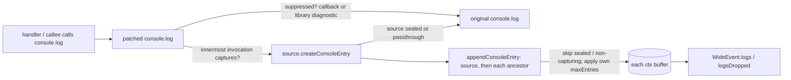

# Capture console.* output from action invocations on the wide event

Issue: #9

## Goal

A user can turn on console capture once (globally, or per action), and every `console.log/info/warn/error/debug/trace` call made while an invocation runs shows up on that invocation's `WideEvent` as `logs`. That includes calls made by plain code the handler calls. Each call is also copied into the `logs` of every capturing ancestor invocation, so a root event shows the whole trace's console output in one array. Each entry carries the `actionId` of the invocation that made it, so a dashboard can filter the trace down to one event. An invocation captures if its own action, or any ancestor invocation, has capture on. Attribution stays correct when invocations run concurrently. Handlers need no code changes. Output still prints to the terminal unless the user opts out, and actions without capture behave exactly as they do today.

## Non-goals

- Capturing output that bypasses `console`: `process.stdout.write`, pino/sonic-boom, native addons.
- Capturing from worker threads or child processes.
- Capturing `console.dir/table/group/assert/count/time*`. They still work and print, but nothing is recorded.
- Stack traces for `console.trace`: only the formatted message is recorded.
- Keeping raw argument references on entries.
- An uninstall API or restoring the original console methods.
- Changing which ALS context user callbacks run in. `invoke()` runs its final `onEvent` in the caller's context and that stays as is; this plan only stops callback output from being captured.
- Browser or non-Node runtimes (the library already imports `node:async_hooks`).
- A `docs/plan/` rationale doc; this plan is the design record.

## Context

- `src/actions/index.ts`
  - `propagationStore` (line 87) is an `AsyncLocalStorage<PropagationContext>`. Each `PropagationContext` holds `actionId`, a `parent` chain, and the invocation's `invocationContext: InvocationContextImpl`.
  - `runWithPropagationContext` (line 106) wraps the handler for all three invocation paths: `invoke` (line 1259), `invokeAll` (line 1548), `invokeStream` (line 1781). Context propagation into child invocations already works through the scheduler (see `src/tests/context-propagation.test.ts`).
  - `InvocationContextImpl` (lines 400–694) holds per-invocation state (attachments, children, progress). Its constructor takes 7 positional params and is called in 3 places (lines 1219, 1522, 1755).
  - Global plus per-action configuration already has a pattern to follow: `setContextWarningThreshold` (line 39) sets a module-level global, `ActionBuilder.setContextWarningThreshold` (line 856) sets per-action options, and `resolveContextWarningOptions` (lines 43–68) merges them field by field **at invoke time**.
  - Five places build a `WideEvent`:
    1. Intermediate (retry or final-failure) event in `executeWithRetry`, line 1108. It runs inside the invocation's store.
    2. `invoke` success, line 1278, in `data.then`, which runs in the caller's context.
    3. `invoke` error/cancel, line 1332, also in the caller's context.
    4. `invokeAll` item `finally`, line 1575, inside the item's store.
    5. `invokeStream` item `finally`, line 1808, inside the item's store.
  - The retry loop is `executeWithRetry` (line 897), with `attemptNumber` as a local.
  - User callbacks are called at:
    - `onWarning` handler: line 595 (the default is `console.warn`, line 593)
    - `progressCallback`: line 682, `invokeAll` batch progress at line 1508, and the matching `invokeStream` batch progress (~line 1737)
    - `shouldRetry`: line 1095
    - `eventCallback`: lines 1137, 1311, 1371, 1616, 1849
  - The library's own diagnostics go through `console.error` at lines 597, 684, 1097, 1139, 1314, 1373, 1510, 1618, ~1739 and 1851.
- `src/tests/regressions.test.ts:230,246` silence library diagnostics by assigning `console.error = () => {}`, so the library must look up `console.error` at call time.
- `src/index.ts` re-exports the public API from `./actions/index.js`.
- Tests: plain `tsx` scripts built on `test`/`assert`/`delay`/`printSection` from `src/tests/helpers.ts`, registered in `src/tests/run-all.ts`, each with a `test:<suite>` script in `package.json`. Existing `*.test.ts` files must not be edited (`.github/copilot-instructions.md`).
- `tsconfig.json` has `strict`, `exactOptionalPropertyTypes` and `noUncheckedIndexedAccess` on, and `src/tests` is excluded from `tsc`.
- Swapping `process.stdout.write` captures `console.log` output (checked on this machine), so tests can observe passthrough without test hooks in the library.
- Baseline: `npm run build && npm test` gives 153 passed, 0 failed.
- Docs: `README.md` sections "Key ideas", "API at a glance" and "API reference (compact)". Examples live in `examples/NN-*.ts`, with `examples/run-all.ts` and `examples/README.md`.

## Decisions

| # | Decision | Alternative considered | Reason |
| - | -------- | ---------------------- | ------ |
| 1 | Opt-in through a global `setConsoleCapture(options?)` plus a per-action `.captureConsole(options \| false)` override | Per-action only; global only | User choice. A single startup call instruments everything, and it mirrors the existing `setContextWarningThreshold` pattern |
| 2 | Options are resolved per invocation, at invoke time. Capture is on if the action's own setting is on (action config, otherwise the global), **or** the parent invocation captures. Each field is merged in this order: the child's explicit value, then the parent's resolved value, then the global, then the default. `.captureConsole(false)` turns capture off only when no ancestor captures | Resolve when `.captureConsole()` is called; child explicit `false` overrides the parent | User direction: "tied to the closest action invocation if the action or its parents have capture logs turned on". Resolving at invoke time keeps the `resolveContextWarningOptions` behavior |
| 3 | A call is recorded on the innermost invocation **and copied to every capturing ancestor**, up to the root. Non-capturing ancestors (only possible above a child that opted in by itself) are skipped | Innermost only; copy only to the nearest capturing ancestor | User direction: "we need to see an event holistically while being able to filter our dashboard to specific events/traces" |
| 4 | Logs print to the terminal by default; `passthrough: false` stops printing, but only for calls that are captured | Always print; capture-only by default | User choice. Turning capture on doesn't change what the terminal shows |
| 5 | Entry = `{ level, message, timestamp, attempt, actionId }`, where `message = util.format(...args)` is computed when `console.*` is called. `actionId` and `attempt` describe the **source** invocation, the innermost one that made the call. One frozen entry object is shared by every buffer it goes into | Also keep raw `args`; per-ancestor copies | User choice for formatted text: it can't change later and always serializes. `actionId` lets a dashboard filter one event out of an ancestor's `logs` (`traceId` is already on every event). Freezing stops a mutation in one event's array from leaking into another |
| 6 | Default limits per invocation: `maxEntries: 1000` and `maxMessageLength: 8192` (counted in UTF-16 code units). Each buffer applies **its own** `maxEntries`, so copied child entries count toward an ancestor's limit; extra entries are dropped and counted in that buffer's `logsDropped`. Messages are cut **once**, at the source invocation's `maxMessageLength`, and marked `truncated: true` | Unbounded; cut separately for each ancestor | User choice for the caps. Cutting once keeps a single shared entry |
| 7 | Output from user callbacks (`onEvent`, `onProgress`, `shouldRetry`, `onWarning`) and the library's own diagnostics is never captured, but still prints | Capture callbacks | User choice. Keeps events from recording their own logging, and avoids the `invoke()` quirk where a child's final `onEvent` runs in the parent's context |
| 8 | Suppression uses a second `AsyncLocalStorage<boolean>` (`captureSuppressedStore`). `runWithPropagationContext` resets it to `false`, so an action invoked from inside a callback still captures its own logs | `propagationStore.exit()` around callbacks | `exit()` would cut trace/parent linkage for actions invoked from callbacks, which changes existing behavior |
| 9 | Library diagnostics go through `runWithoutCapture(() => console.error(...))`, which still looks up `console.error` when called | Bind the original console methods once at module load | Keeps existing `console.error = () => {}` stubs working (`regressions.test.ts`) |
| 10 | Once the final event is built, the invocation's buffer is sealed; later calls are not added to it. A late call whose source is sealed still prints, whatever `passthrough` is set to, and still goes into any ancestor buffers that are not sealed yet. No counter or warning | Report via `onWarning` | User choice. By then the event has already been emitted. Copying to unsealed ancestors keeps the parent's view complete |
| 11 | Retry intermediate events carry all entries so far; each entry is tagged with `attempt` (0 = original). The final event has the full history | Per-attempt only | User choice |
| 12 | Captured methods: `log`, `info`, `warn`, `error`, `debug`, `trace` | Without `trace` | User choice |
| 13 | The patch goes in on the first enable (`setConsoleCapture(opts)` or `.captureConsole(opts)`), only once, and is never removed. Each wrapper forwards to whatever that method was at install time | Restore when capture is disabled | User choice. There is no GC hook to track live actions |
| 14 | The event has `logs` (possibly `[]`) whenever capture is on for that invocation; `logsDropped` appears only when it is > 0. Both fields are absent when capture is off | Always include `logs` | Actions without capture produce exactly the same events as before (an issue acceptance criterion) |
| 15 | Bad limits throw `Error` from `setConsoleCapture`/`.captureConsole`: `maxEntries` must be an integer >= 0, `maxMessageLength` an integer >= 1 | Clamp silently | Matches the existing setter validation (`setRetry`, `setTimeout`, `onProgress`) |

## Design

### Public API (`src/actions/index.ts`, re-exported from `src/index.ts`)

```ts
export type ConsoleLevel = 'log' | 'info' | 'warn' | 'error' | 'debug' | 'trace';

export interface ConsoleLogEntry {
    level: ConsoleLevel;
    /** util.format(...args) at call time, truncated to the source invocation's maxMessageLength */
    message: string;
    /** Epoch ms */
    timestamp: number;
    /** Source invocation's retry attempt when logged (0 = original) */
    attempt: number;
    /** Source invocation: the innermost action invocation that made the call */
    actionId: string;
    /** Present when message was cut to maxMessageLength */
    truncated?: true;
}

export interface ConsoleCaptureOptions {
    /** Still print captured calls to the terminal (default: true) */
    passthrough?: boolean;
    /** Max entries kept per invocation; extra entries are counted in logsDropped (default: 1000) */
    maxEntries?: number;
    /** Max message length in UTF-16 code units (default: 8192) */
    maxMessageLength?: number;
}

/** Enable capture for every action (undefined clears the global default). */
export const setConsoleCapture: (options?: ConsoleCaptureOptions) => void;

// ActionBuilder
captureConsole(options: ConsoleCaptureOptions | false = {}): ActionBuilder<I, O>;

// WideEvent additions
logs?: ConsoleLogEntry[];
logsDropped?: number;
```

### Module state

```ts
let globalConsoleCaptureOptions: ConsoleCaptureOptions | undefined;
type ResolvedConsoleCapture = Required<ConsoleCaptureOptions>;
const CONSOLE_CAPTURE_DEFAULTS: ResolvedConsoleCapture = { passthrough: true, maxEntries: 1000, maxMessageLength: 8192 };
const CAPTURED_CONSOLE_LEVELS: readonly ConsoleLevel[] = ['log', 'info', 'warn', 'error', 'debug', 'trace'];
let consoleCaptureInstalled = false;
const captureSuppressedStore = new AsyncLocalStorage<boolean>();
const runWithoutCapture = <T>(fn: () => T): T => captureSuppressedStore.run(true, fn);
```

- `validateConsoleCaptureOptions(options)` throws on bad limits (Decision 15). Both setters call it.
- `resolveConsoleCaptureOptions(action: ConsoleCaptureOptions | false | undefined, inherited: ResolvedConsoleCapture | undefined): ResolvedConsoleCapture | undefined`. `inherited` is the parent invocation's resolved settings.
  - Capture is on when `inherited !== undefined`, or when `action !== false && (action !== undefined || global !== undefined)`.
  - Otherwise the result is `undefined`.
  - When on, each field is `actionObj?.x ?? inherited?.x ?? global?.x ?? default.x`, where `actionObj` is `action` if it is an object.
  - Because `inherited` is already resolved, enablement passes down through intermediate actions that have no config.
- `runWithPropagationContext` becomes `captureSuppressedStore.run(false, () => propagationStore.run(context, fn))`.

### Console patch

`installConsoleCapture()` is idempotent (guarded by `consoleCaptureInstalled`). For each level in `CAPTURED_CONSOLE_LEVELS` it saves `const original = console[level]` and replaces the method with:

```ts
function (...args: unknown[]) {
    let print = true;
    const store = propagationStore.getStore();
    if (store && captureSuppressedStore.getStore() !== true && store.invocationContext.capturesConsole()) {
        const source = store.invocationContext;
        const entry = source.createConsoleEntry(level, args); // format + cut at source limit, frozen
        print = source.isConsoleSealed() || source.getConsoleCapture()!.passthrough;
        for (let p: PropagationContext | undefined = store; p; p = p.parent) {
            p.invocationContext.appendConsoleEntry(entry); // no-op if not capturing or sealed; applies own maxEntries
        }
    }
    if (print) original.apply(console, args);
}
```

Whether to print is decided only by the source invocation, so a call prints at most once. A late call from a sealed child still goes into ancestors that are not sealed yet (Decision 10).

The library calls `installConsoleCapture()` from `setConsoleCapture` when `options !== undefined`, and from `.captureConsole` when `options !== false`.

### `InvocationContextImpl` additions

- A new 8th constructor param `consoleCapture: ResolvedConsoleCapture | undefined`. All 3 construction sites pass a value computed once per `invoke`/`invokeAll`/`invokeStream` call (next to `warningOptions`), as `resolveConsoleCaptureOptions(this.consoleCaptureOptions, parentPropagationContext?.invocationContext.getConsoleCapture())`.
- New private state: `consoleLogs: ConsoleLogEntry[]`, `consoleLogsDropped = 0`, `consoleSealed = false`, `attempt = 0`.
- `capturesConsole(): boolean` returns `consoleCapture !== undefined`; `getConsoleCapture()` returns `consoleCapture`; `isConsoleSealed()` returns `consoleSealed`.
- `createConsoleEntry(level, args): ConsoleLogEntry` does `util.format(...args)`, cuts it to this context's `maxMessageLength` (setting `truncated: true` when cut), and returns `Object.freeze({ level, message, timestamp: Date.now(), attempt: this.attempt, actionId: this.actionId, ... })`.
- `appendConsoleEntry(entry): void`:
  - not capturing, or sealed → return;
  - `consoleLogs.length >= maxEntries` → increment `consoleLogsDropped`;
  - otherwise push.
- `setAttempt(n)` sets `attempt`; `sealConsole()` sets `consoleSealed`.
- `getConsoleLogFields(): { logs?: ConsoleLogEntry[]; logsDropped?: number }` returns `{}` when capture is off. Otherwise it returns `{ logs: [...consoleLogs] }`, plus `logsDropped` when it is > 0.

### Wiring

- `ActionBuilder` gets a new field `private consoleCaptureOptions: ConsoleCaptureOptions | false | undefined`.
- `executeWithRetry`: call `context.setAttempt(attemptNumber)` at the top of each loop iteration.
- Every `WideEvent` site (the five listed in Context) adds `...context.getConsoleLogFields()` right after `attachments`.
- The final-event sites (2–5) call `context.sealConsole()` before building the event.
- Callback isolation (Decision 7):
  - every user callback call listed in Context becomes `runWithoutCapture(() => cb(...))`;
  - every library `console.error(...)` diagnostic becomes `runWithoutCapture(() => console.error(...))`;
  - `emitWarning` wraps `handler(warning)`, which also covers the default `console.warn`;
  - awaited callbacks become `await runWithoutCapture(() => this.eventCallback!(e))`.

### Data flow



## Testing

New suite `src/tests/console-capture.test.ts`, registered in `src/tests/run-all.ts` as "Console Capture Tests" and as `test:console-capture` in `package.json`. Tests watch terminal output by temporarily replacing `process.stdout.write`/`process.stderr.write` (restored in `finally`). Any test that calls `setConsoleCapture` clears it in `finally`. Existing test files are not touched.

Step 1 (configuration):
- `setConsoleCapture` and `.captureConsole` throw for `maxEntries: -1`, `maxEntries: 1.5` and `maxMessageLength: 0`.

Step 2 (capture):
- With `.captureConsole()`, all six levels are recorded in call order with the right `level`. `message` matches `util.format` (`%s`/`%d`, objects), `startedAt <= timestamp <= completedAt`, `attempt` is 0, `actionId` is the event's, and entries are frozen.
- An action without capture (and no global setting) emits an event with no `logs` key, and the output still prints.
- Concurrency 2, with two invocations interleaving logs across `delay`s: each event holds only its own messages.
- Passthrough: the default prints captured text. With `passthrough: false` captured text is not printed, while a `console.log` outside any invocation still prints.
- Global: `setConsoleCapture({})` means an action with no config captures, and `.captureConsole(false)` does not. With a global `passthrough: false` and an action `maxEntries: 2`, both settings apply.
- Limits: `maxEntries: 2` with 5 logs gives 2 entries and `logsDropped: 3`. `maxMessageLength: 5` gives a 5-character message with `truncated: true`. With no truncation there is no `logsDropped` key.
- Retry: attempt 0 logs `a0` and throws; attempt 1 logs `a1` and succeeds. The intermediate event's `logs` is `[a0@0]` and the final event's is `[a0@0, a1@1]`.
- Nesting (copy to ancestors and inheritance):
  - A capturing parent logs `p1`, invokes a child with no config that logs `c`, then logs `p2`. Parent `logs` is `[p1, c, p2]` in order, with `c.actionId` set to the child's id. The child's own event and the parent's `children[0].logs` are both `[c]`.
  - Three levels: a grandchild's call appears in the grandchild's, child's and root's `logs`, each time with the grandchild's `actionId`.
  - A parent runs `invokeAll` over 3 children that log concurrently. Parent `logs` holds all 3 children's entries with the correct `actionId`s; each child event holds only its own.
  - Under a capturing parent, a child with `.captureConsole(false)` still captures and is copied, because an ancestor's capture wins.
  - Inheritance goes through an intermediate action with no config, so a grandchild captures and is copied to both ancestors.
  - Limits:
    - With a parent `maxEntries: 2`, a child with `{ maxEntries: 5 }` that logs 3 times has 3 entries, while the parent has 2 entries and `logsDropped: 1`.
    - A child with no config under the same parent inherits `maxEntries: 2`.
    - With a parent `maxMessageLength: 5` and a child `{ maxMessageLength: 100 }`, the parent's copy of the child's 20-character message is not cut, because cutting uses the source's limit.
  - With no global setting, a non-capturing parent and a capturing child: the child's event has `logs` and the parent's event has no `logs` key.
  - A late child call (child forced timeout, logged after the child's event, while the parent is still running) is in the parent's `logs` and not in the child's.
  - Passthrough follows the source: a parent `{ passthrough: false }` with a child `{ passthrough: true }` prints the child's call exactly once, and does not print the parent's own call.
- `invokeAll` and `invokeStream`: each item event has only its own logs.
- Cancel: an `invoke` cancelled while running emits a cancellation event that keeps the logs made before the cancel.
- Late logs: with a forced timeout (`setTimeout(20)`), the handler logs `late` at 50 ms. `late` is missing from the event but still prints.

Step 3 (isolation):
- A capturing parent invokes a child whose `onEvent` logs `cb`. `cb` is missing from the parent's `logs`; this is the `invoke()` caller-context case, where the child's final `onEvent` runs in the parent's context.
- On a capturing action:
  - an `onEvent` that logs `cb` during a retry intermediate event (which runs inside the store before sealing) leaves `cb` out of the final event's `logs`;
  - `onProgress` logs (triggered by `ctx.incrementProgress()`) are not captured;
  - `shouldRetry` logs are not captured;
  - `onWarning` logs (from `setContextWarningThreshold({ maxAttachmentBytes: 1, onWarning })`) are not captured.
- Library diagnostic: on a capturing, retrying action whose `onEvent` throws on the intermediate event, the final event's `logs` contain no `Error in event callback`.
- An action invoked from inside another action's `onEvent`, with capture on, still captures its own handler logs.

Every step: `npm run build && npm test` (the `test_command`) passes.

Manual (`dev_environment` is empty): run `npx tsx examples/14-console-capture.ts` and check that the printed wide events show `logs` for each invocation, separated by request.

## Steps

- [ ] 1. Add the configuration API: the `ConsoleLevel`, `ConsoleLogEntry` and `ConsoleCaptureOptions` types, the `WideEvent.logs`/`logsDropped` fields, `setConsoleCapture`, `ActionBuilder.captureConsole`, validation and `resolveConsoleCaptureOptions`, plus exports from `src/index.ts`. Create `src/tests/console-capture.test.ts` with the validation tests and register it in `run-all.ts` and `package.json`. `installConsoleCapture` is not written yet; the setters only store options.
- [ ] 2. Implement capture. This covers `installConsoleCapture` (called from both setters), the `InvocationContextImpl` buffer (`recordConsole`, `setAttempt`, `sealConsole`, `getConsoleLogFields`, `getConsoleCapture`, constructor param) and innermost-invocation routing. Pass options resolved with parent inheritance at the 3 construction sites, call `setAttempt` in `executeWithRetry`, and spread the fields and seal at the 5 event sites. Add the Step 2 tests.
- [ ] 3. Isolate callbacks and library diagnostics: add `captureSuppressedStore`/`runWithoutCapture`, make `runWithPropagationContext` reset suppression, and wrap every user callback call and library `console.error` diagnostic. Add the Step 3 tests.
- [ ] 4. Docs and example:
  - `README.md`: a "Console capture" subsection under Key ideas (enabling it, passthrough, limits, nesting, what isn't captured), plus API-at-a-glance and reference-table rows.
  - `examples/14-console-capture.ts`, registered in `examples/run-all.ts` and `examples/README.md`.

## Risks & open questions

- *Accepted:* if another tool (an APM agent or test runner) replaces a console method after the patch is installed, capture stops for that method. This will be documented in the README.
- *Accepted:* when a forced timeout overlaps a retry, late logs from the timed-out attempt's handler are tagged with the source invocation's current attempt number, because `attempt` is read from the context when `console.*` is called.
- *Accepted:* output from callbacks registered outside the invocation (EventEmitter listeners attached at startup) and from libraries that lose ALS context is not captured. This will be documented in the README.
- *Accepted:* once the patch is installed, every `console.*` call in the process pays for one or two ALS `getStore()` calls. Captured calls also walk the invocation's parent chain, which grows with nesting depth.
- *Accepted:* nested events repeat entries. A depth-`d` call appears in `d + 1` `logs` arrays, and a serialized root event repeats it through `children[i].logs`. Dashboards can filter on entry `actionId`.
- *Accepted:* a busy trace can fill the root's `maxEntries` (default 1000) with child entries. `logsDropped` on the root reports the loss, and the limit can be configured.
- *Accepted:* a fire-and-forget child action that finishes after its parent's event is emitted is missing from the parent's `children` (existing behavior). Its calls made before the parent was sealed are in the parent's `logs`; later calls are only on the child's own event.

## Implementation notes

## Review
