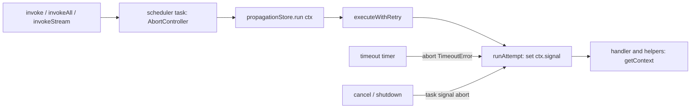

# Access invocation context and abort signal without handler wrappers

Issue: #16

## Goal

Any handler passed to `createAction(handler)`, and any function it calls (sync or async, at any depth), can call `getContext()` to get the running invocation's `InvocationContext`. That context now has a `signal` property, which is aborted when the current attempt times out or the invocation is cancelled. Nested actions see their own context, with `parent` pointing at the caller. The wrappers `withContext` and `withAbortSignal` and the `TimeoutOptions.abortSignal` flag are removed. The API is pre-1.0 and unstable, and the README now says so. Timeouts always reject promptly, and they also abort `ctx.signal` so the handler can stop its work. Actions that never call `getContext()` allocate nothing new per invocation.

## Non-goals

- Defining `getContext()` inside lifecycle callbacks (`onEvent`, `onProgress`, `shouldRetry`, `onWarning`). What it returns there depends on where the library calls the callback: a final `onEvent` for `invoke()` runs in the caller's context. The docs say callbacks get their data from their arguments.
- A non-throwing variant (`tryGetContext()`), or returning `undefined` outside an invocation.
- A cooperative timeout mode that waits for the handler to stop on its own.
- Keeping context across boundaries that `AsyncLocalStorage` doesn't follow: callbacks fired by emitters or worker loops created outside the invocation, worker threads, child processes.
- A version bump. `package.json` stays at `0.5.0`, and releasing is a separate change.
- Rewriting the snippets in `docs/plan/`. They get a "superseded" banner only.
- Fixing the wrong-argument bug in `withAbortSignal` on its own. It goes away when the wrapper is removed (see Context).

## Context

- `src/actions/index.ts`
  - `propagationStore` (line 171) is an `AsyncLocalStorage<PropagationContext>`. Each `PropagationContext` already holds `invocationContext: InvocationContextImpl` (line 168).
  - `runWithPropagationContext` (line 230) wraps the work in `propagationStore.run`. Both scheduling paths use it: `invoke` (line 1543) and `startBatch` for `invokeAll`/`invokeStream` (line 1753). Both call `executeWithRetry(run, signal)`, passing the scheduler's per-task `AbortSignal`.
  - `InvocationContextImpl` (line 583) is created unconditionally for every invocation (lines 1510, 1721). It already has `setAttempt` (line 931), which `executeWithRetry` calls at the top of each attempt (line 1238).
  - `InvocationContext` interface: line 406. `TimeoutOptions` (line 364) includes `abortSignal?: boolean` (line 370).
  - `ActionBuilder` detects wrappers in its constructor (lines 1037–1050) with `if / else if`, so the two wrappers can't be combined. The flags `usesContext` (line 1017) and `usesAbortSignal` (line 1023) and the unused `setUsesContext` (line 1181) exist only for this.
  - `executeWithRetry` (lines 1215–1482) has four ways to run the handler:
    1. cooperative timeout (`abortSignal: true` plus `withAbortSignal`), which does not race and passes `timeoutController.signal` (lines 1248–1293);
    2. forced timeout race (lines 1294–1344);
    3. no timeout but a scheduler signal, raced against cancellation (lines 1348–1382);
    4. no signal (lines 1384–1394). This is unreachable, because both callers always pass a signal.
  - **Live bug, verified:** in path 2, a `withAbortSignal` handler gets no signal, so its `signal` parameter receives the first payload argument. `createAction(withAbortSignal(async (signal, n: number) => …)).setTimeout(1000).invoke(5)` → `signal === 5`.
  - `withContext` (line 1925) and `withAbortSignal` (line 1944) tag a throwing stub with `__usesContext` / `__usesAbortSignal` / `__originalHandler`.
- `src/scheduler/index.ts`
  - Every scheduled task gets a `new AbortController()` (line 137).
  - Cancel aborts it with the cancel reason (line 473); shutdown uses `'Shutdown'` / `'Shutdown timeout'` (lines 516, 561).
- `src/index.ts` re-exports `withContext` and `withAbortSignal` (lines 4–5).
- Per-invocation cost that exists today, used or not: one `InvocationContextImpl`, one `AbortController`, and one `propagationStore.run`. So `getContext()` is a single `getStore()` read.
- Verified on Node 22 with a throwaway script: an ALS store survives sync helpers, async helpers after `await`, `setTimeout` callbacks, and emitters created and emitted inside the run. Concurrent runs stay isolated. A listener on an emitter created outside the run and fired from outside sees no store.
- Tests are plain `tsx` scripts using `test`/`assert`/`delay`/`printSection` from `src/tests/helpers.ts`. Each suite is registered in `src/tests/run-all.ts` and has a `test:<suite>` script in `package.json`. `src/tests/test-infra.test.ts` requires every suite in `run-all` to report at least one test. `src/tests` is excluded from `tsc`.
- Wrapper usage in tests: `cancellation` (3), `console-capture` (3), `context-propagation` (7), `progress` (17), `retry` (2), `timeout` (4), `wide-events` (12) occurrences, including imports.
  - `timeout.test.ts` tests 9–10 (lines 198–260) use `withAbortSignal` with `abortSignal: true`.
  - `cancellation.test.ts` (lines 46–83) uses `withAbortSignal` and asserts that the signal is aborted on cancel.
- `.github/copilot-instructions.md` documents the wrappers as a convention and says "Don't edit existing tests in `src/tests/*.test.ts`".
- Docs that use the wrappers:
  - `README.md`: quick start (lines 16–40), "Wrappers opt-in handler extras" (lines 44–46), the timeouts bullet (line 58), API at a glance (line 92), and reference rows (lines 105–106, 112).
  - `examples/`: 04, 06, 07, 08, 09, 10, 11 and 12, plus snippets in `examples/README.md`. `examples/run-all.ts` lists 01–09 and 14.
  - `docs/plan/`: `cancellation.md`, `context-propagation.md`, `priority-overrides.md`, `progress-tracking.md`, `timeouts.md`, `wide-event-attach-api.md`.
- Engines: Node >= 22. Baseline `npm run build && npm test`: 196 passed, 0 failed.

## Decisions

| # | Decision | Alternative considered | Reason |
| - | -------- | ---------------------- | ------ |
| 1 | Add an ambient `getContext(): InvocationContext`, read from `propagationStore` | Pass a trailing `{ ctx, signal }` handler argument; take a second `createAction` argument | Handler arguments vary in number and may be optional or defaulted, so a trailing argument would land in a user parameter (`(a, b = 5)` → `b = ctx`). Per-invocation values can't sit in a per-action option. ALS is already entered on every invocation |
| 2 | `getContext()` **throws** outside an invocation; there is no non-throwing variant | Also export `tryGetContext()`; return `undefined` | User choice. One export, and mistakes fail loudly |
| 3 | `getContext()` returns the **innermost** invocation's context. Plain helpers share the caller's context; a nested action gets its own, with `parent` linking to the caller | Always return the root | Matches the existing trace/child model |
| 4 | Add `InvocationContext.signal: AbortSignal`, fresh **per attempt**. Without a timeout it is the scheduler's task signal (no allocation). With a timeout it is a per-attempt controller's signal, linked to the task signal | One signal per invocation | A timed-out attempt's signal must stay aborted while the retry gets a live one |
| 5 | On timeout, `ctx.signal` is aborted with reason `TimeoutError`, and the attempt still rejects promptly (race). On cancel, it is aborted with the cancel reason (`'Shutdown'` / `'Shutdown timeout'` on shutdown). Earlier attempts' signals are aborted on cancel too (the `{ once: true }` link stays) | Cooperative wait for the handler | User choice ("always enforce + abort"). Non-breaking for handlers that ignore the signal. Link listeners are bounded by `maxRetries + 1` per task |
| 6 | **Remove** `withContext`, `withAbortSignal`, the wrapper-detection flags and `setUsesContext` | Keep them; keep with `@deprecated` | User choice: pre-1.0 and unstable. This also removes the wrong-argument bug and the "can't combine" limitation |
| 7 | Remove `TimeoutOptions.abortSignal`. `TimeoutOptions = { duration, throwOnTimeout? }` | Keep it as a cooperative mode for every handler | User choice. With the wrapper gone it has no meaning, and a cooperative mode would leave handlers that ignore the signal with no time limit |
| 8 | `executeWithRetry` gets one attempt path: `runAttempt` races the handler against cancellation and, if configured, the timeout. The unreachable no-signal path is deleted and `signal` becomes required | Keep the four branches | Removing the wrappers leaves one way to call the handler: `this.callbackHandler(...payload)` |
| 9 | Migrate the existing tests that use the wrappers to `getContext()`, keeping the same assertions. Amend the repo rule in `.github/copilot-instructions.md` to allow editing existing tests when a public API they use is removed or renamed | Migrate as a one-time exception | User choice |
| 10 | README gets a stability disclaimer near the top ("pre-1.0: the API is unstable and may change between minor versions; this notice will be removed at 1.0.0") | No disclaimer | User direction |
| 11 | Docs: the README quick start and Key ideas switch to `getContext()`. All examples 04–12 are migrated. A new `examples/15-get-context.ts` shows nested helpers, nested actions and `signal`. `examples/README.md` is updated | README only | User choice |
| 12 | `docs/plan/` docs that use the wrappers get a one-line superseded banner pointing at the README | Rewrite the snippets; leave them untouched | User choice. Keeps the design history |
| 13 | `getContext()` inside lifecycle callbacks is unspecified and documented as such | Wrap every callback site | User choice. Wrapping would also change trace linkage for actions invoked from callbacks |
| 14 | No version bump | Bump to 0.6.0 | User choice |
| 15 | The error message is `getContext() must be called during an action invocation (inside a handler or a function it calls)` | Generic message | It names the rule a user broke |

## Design

### Public API (`src/actions/index.ts`, re-exported from `src/index.ts`)

```ts
export interface InvocationContext {
    // ...existing members...
    /**
     * Aborted when the current attempt times out (reason: TimeoutError) or the
     * invocation is cancelled (reason: the cancel reason). Each retry attempt gets a fresh signal.
     */
    readonly signal: AbortSignal;
}

export interface TimeoutOptions {
    duration: number;
    throwOnTimeout?: boolean;
}

/** The running invocation's context; throws when called outside one. */
export function getContext(): InvocationContext;
```

Removed exports: `withContext`, `withAbortSignal`.

### `getContext`

```ts
export function getContext(): InvocationContext {
    const store = propagationStore.getStore();
    if (!store) {
        throw new Error('getContext() must be called during an action invocation (inside a handler or a function it calls)');
    }
    return store.invocationContext;
}
```

### `InvocationContextImpl`

- New field `private attemptSignal: AbortSignal | undefined`, with `get signal(): AbortSignal`.
  - The getter returns `attemptSignal`. `executeWithRetry` sets it before any user code runs, so the only way to reach `undefined` is a library bug. In that case the getter throws `Error('signal accessed before the first attempt')`.
- `setAttemptSignal(signal: AbortSignal): void`.

### `executeWithRetry(run, signal: AbortSignal)`

Per attempt, after the existing pre-attempt cancellation check and `context.setAttempt(attemptNumber)`:

```ts
const attemptStartTime = Date.now();
try {
    result = await this.runAttempt(context, payload, signal);
    error = undefined;
    break;
} catch (e) {
    if (e instanceof TimeoutError) {
        executionTime = Date.now() - attemptStartTime;
        timedOut = true;
        if (this.timeoutConfig!.throwOnTimeout === false) { result = undefined; error = undefined; break; }
    }
    // ...existing retry/shouldRetry/intermediate-event handling unchanged...
}
```

`runAttempt(context, payload, signal)`:

1. If `signal.aborted`, throw `CancellationError(reason, 'running')`.
2. Signal:
   - no `timeoutConfig` → `context.setAttemptSignal(signal)`;
   - otherwise create `attempt = new AbortController()`, call `signal.addEventListener('abort', () => attempt.abort(signal.reason), { once: true })`, then `context.setAttemptSignal(attempt.signal)`.
3. Build the race:
   - `Promise.resolve().then(() => this.callbackHandler(...payload))`, so a synchronous throw becomes a rejection;
   - a cancellation promise that rejects with `CancellationError(reason, 'running')` on task-signal abort;
   - when a timeout is configured, a timer that calls `attempt.abort(new TimeoutError(duration))` and rejects with a new `TimeoutError(duration)`.
4. `finally`: `clearTimeout(timer)`. The `{ once: true }` link listener is kept on purpose (Decision 5).

How the outcome is decided, so that the existing timeout and cancellation tests keep their meaning:

- A handler rejection that races in **after** the task signal aborted is reported as `CancellationError` (same as path 1 today).
- A handler rejection after a timeout abort loses the race to the timeout rejection, which was queued first. The attempt reports `TimeoutError`.

### `ActionBuilder`

- The constructor becomes `this.callbackHandler = handler; this.scheduler = new ExecutionScheduler();`.
- Delete `usesContext`, `usesAbortSignal` and `setUsesContext`.
- `setTimeout` keeps its validation. Its type no longer has `abortSignal`.

### Control flow



## Testing

New suite `src/tests/get-context.test.ts`, registered in `src/tests/run-all.ts` as "getContext Tests" and in `package.json` as `test:get-context`.

Step 1 (`getContext`):
- In a plain handler, `getContext().attach(...)` lands on the event's `attachments`. `getContext().setTotal`/`incrementProgress` drive `onProgress`.
- From a sync helper, an async helper (after `await delay`) and a `setTimeout` callback inside the handler, `getContext()` returns the invocation's context: `actionId` matches the event, and their attachments are on that event.
- With concurrency 2 and two invocations interleaving across `delay`s, each event carries only its own attachments.
- Nested action:
  - in the child, `getContext().actionId` is the child event's id and `getContext().parent?.actionId` is the parent's;
  - a helper the parent calls after the child returns still gets the parent's context.
- `invokeAll` and `invokeStream`: each item's `getContext().actionId` equals its result's `actionId`.
- Called at top level, both before any invocation and after one completes, `getContext()` throws an `Error` whose message contains `during an action invocation`.

Step 2 (`signal`):
- Without a timeout: `getContext().signal` is an `AbortSignal` and is not aborted during a normal run. Cancelling a running invocation aborts it, with `reason === 'User cancelled'`.
- A timeout of 50 ms on a handler that ignores the signal and sleeps 300 ms: `data` rejects with `TimeoutError` in under 200 ms, and the captured signal is aborted with `reason instanceof TimeoutError`.
- `throwOnTimeout: false`: the signal is still aborted and the event has `timedOut: true`.
- Retry with a timeout: attempt 0 times out, and attempt 1 gets a different signal object that is not aborted while it runs. Attempt 0's signal stays aborted.
- A helper several calls deep reads `getContext().signal`, which is the same object the handler sees.

Step 3 (removal): the migrated suites keep their assertions and pass. Throwaway check: `createAction(async (n: number) => n).setTimeout(1000).invoke(5)` resolves to `5`. The equivalent `withAbortSignal` call today returns `signal === 5`.

Every step: `npm run build && npm test` passes.

Manual (`dev_environment` is empty):
- Run `npx tsx examples/15-get-context.ts`. Attachments from a helper two calls deep should appear on the root event, the nested action's event should show its own `actionId` with `parent` set, and the timeout demo should report `signal aborted: TimeoutError`.
- Run `npx tsx examples/run-all.ts`; all examples should pass.

Throwaway overhead check, reported but not committed: time 50 000 `invoke` calls of a plain handler on `dev` and on the branch, and compare.

## Steps

- [ ] 1. Add `getContext()` and export it from `src/index.ts`. Create `src/tests/get-context.test.ts` with the Step 1 tests and register it in `run-all.ts` and `package.json`. The wrappers are left alone.
- [ ] 2. Add `InvocationContext.signal`, `InvocationContextImpl.setAttemptSignal` and the per-attempt signal wiring in `executeWithRetry`. Timeouts abort the attempt signal (reason `TimeoutError`), cancel aborts it (the cancel reason), and every path, including the `withAbortSignal` paths, sets the signal before the handler runs. Add the Step 2 tests.
- [ ] 3. Remove `withContext`, `withAbortSignal`, the wrapper flags, `setUsesContext` and `TimeoutOptions.abortSignal`. Collapse the execution paths into `runAttempt` (Design), and make `signal` required on `executeWithRetry`. Migrate the 7 test suites to `getContext()` with their assertions unchanged. Update `.github/copilot-instructions.md`: replace the wrapper convention with `getContext()`, and amend the tests rule (Decision 9).
- [ ] 4. Docs:
  - `README.md`:
    - stability disclaimer;
    - quick start using `getContext()`;
    - a "Context & cancellation signal" Key idea replacing "Wrappers opt-in handler extras", covering helpers, nested actions, the throw outside an invocation, callbacks unspecified, and lost-context boundaries;
    - timeouts bullet and reference rows without `abortSignal`/wrappers;
    - a `getContext` row.
  - Superseded banner on the 6 `docs/plan/` docs.
- [ ] 5. Examples:
  - migrate 04, 06, 07, 08, 09, 10, 11 and 12 to `getContext()` (12's import path is fixed to `../src/index.js` if it is broken);
  - add `examples/15-get-context.ts`;
  - register 15 in `examples/run-all.ts`;
  - update the `examples/README.md` index and snippets.

## Risks & open questions

- Breaking change for every user of the wrappers or `abortSignal`. *Accepted*: the project is pre-1.0, and the README disclaimer covers it.
- Adding a required `signal` member to the exported `InvocationContext` breaks user code that implements the interface itself (for example, hand-written mocks). *Accepted*.
- JS (untyped) callers that still pass `abortSignal: true` have it silently ignored. Timeouts are enforced either way. *Accepted*.
- Context is lost in callbacks from emitters or worker loops created outside the invocation. *Accepted*: documented, and `getContext()` throws there instead of misattributing.

## Implementation notes

## Review
